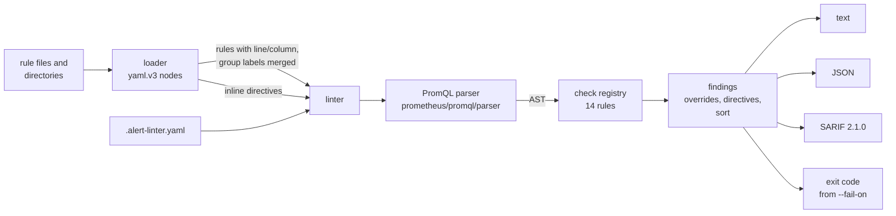

# alert-linter

A fast, single-binary linter for Prometheus alerting rules that catches the on-call anti-patterns behind noisy, unactionable pages.

[](https://github.com/mohammed-saaduddin-ansari/alert-linter/actions/workflows/ci.yml)

`promtool check rules` tells you whether Prometheus can *load* a rule. It does not tell you whether the rule will wake someone at 03:00 for a CPU spike nobody can act on, page forty times for one bad rollout, or arrive with no runbook. `alert-linter` checks for those things in CI, before the rule ships, with output for humans (text), scripts (JSON) and GitHub code scanning (SARIF).

The goal is **fewer, better pages**: every page should be urgent, actionable, owned and explained.

A clean-room reference implementation of a pattern I've worked with in production; no employer or client code.

## Contents

- [Quickstart](#quickstart)
- [Example output](#example-output)
- [Rules](#rules)
- [Configuration](#configuration)
- [Inline directives](#inline-directives)
- [GitHub Actions and code scanning](#github-actions-and-code-scanning)
- [How it works](#how-it-works)
- [Design decisions and trade-offs](#design-decisions-and-trade-offs)
- [Limitations](#limitations)
- [Roadmap](#roadmap)

## Quickstart

Needs Go 1.26.7 or newer.

```sh
git clone https://github.com/mohammed-saaduddin-ansari/alert-linter
cd alert-linter
make build                               # -> bin/alert-linter

bin/alert-linter examples/bad-rules.yaml # 18 findings, exit code 1
bin/alert-linter examples/good-rules.yaml # 0 findings, exit code 0
bin/alert-linter --list-rules
```

Or install it straight onto your `PATH`:

```sh
go install github.com/mohammed-saaduddin-ansari/alert-linter/cmd/alert-linter@main
alert-linter path/to/rules/
```

Usage:

```text
alert-linter [flags] <file-or-directory>...

  --config FILE     config file (default: .alert-linter.yaml in the working directory, if present)
  --format FORMAT   text (default), json or sarif
  --output FILE     write the report to a file instead of stdout
  --fail-on LEVEL   lowest severity that fails the run: error (default), warning, info or never
  --list-rules      list all rules and exit
  --version         print the version and exit
```

Exit codes: `0` no findings at or above `--fail-on`; `1` findings at or above `--fail-on`; `2` usage error, unreadable file or invalid config.

Inputs can be plain Prometheus rule files or Kubernetes `PrometheusRule` manifests (prometheus-operator), including multi-document YAML. Directories are walked recursively for `*.yml`/`*.yaml` files that contain rule groups.

## Example output

Selected findings from `bin/alert-linter examples/bad-rules.yaml` (the full output is in [`testdata/golden/bad.txt.golden`](testdata/golden/bad.txt.golden)):

```text
examples/bad-rules.yaml:8:16: error: paging alert "HostHighCPU" (severity=critical) has no `for:`, so one bad evaluation pages someone [paging-missing-for]
    hint: add `for: 5m` (or whatever the condition needs to be meaningful) so it must persist before anyone is woken
examples/bad-rules.yaml:9:15: warning: paging alert "HostHighCPU" (severity=critical) fires on a resource cause (node_cpu_seconds_total) rather than a symptom users feel [cause-based-paging]
    hint: page on error rate, latency or SLO burn rate and send this one to a ticket (e.g. severity: warning); for disks, a predict_linear() time-to-full alert is a reasonable page
examples/bad-rules.yaml:9:15: warning: paging alert "HostHighCPU" aggregates by (instance), so one incident fans out into one page per instance [high-cardinality-grouping]
    hint: page at the service level (e.g. `sum by (namespace, job)`) and list affected instances in the description or dashboard
examples/bad-rules.yaml:10:9: warning: alert "HostHighCPU" has no owner label (team or owner) [missing-owner-label]
    hint: add a team label on the rule or once on the rule group's `labels:` so routing reaches the people who can fix it
examples/bad-rules.yaml:12:9: error: paging alert "HostHighCPU" has no runbook_url annotation [missing-runbook-url]
    hint: link a runbook that says what to check first and how to mitigate
examples/bad-rules.yaml:33:15: error: "APIHighErrorRate": rate(http_requests_total{code=~"5..",job="api"}[30s]), rate(http_requests_total{job="api"}[30s]) use windows shorter than 4 x the 1m scrape interval (4m); one missed scrape leaves too few samples and the expression returns nothing [rate-window-too-short]
    hint: use a window of at least 4m, or set scrape_interval in the config if your targets are scraped faster
examples/bad-rules.yaml:70:16: error: alert "PodCrashLooping" is defined again with identical labels (first at examples/bad-rules.yaml:47) [duplicate-alert]
    hint: Alertmanager cannot tell the two apart, so silences, inhibitions and grouping act on both; delete one or give them distinct labels such as different severity tiers
examples/bad-rules.yaml:83:15: error: "OrderQueueBacklog" has an expression that does not parse: 1:39: parse error: unclosed left parenthesis [invalid-rule]
...

18 findings (8 errors, 10 warnings) in 1 file; checked 8 alerts and 1 recording rule
```

Each line is `file:line:column`, so it is clickable in most editors and terminals. The same findings as [JSON](testdata/golden/bad.json.golden) and [SARIF](testdata/golden/bad.sarif.golden) are checked in as golden files. The good sample produces:

```text
0 findings (0 errors, 0 warnings) in 1 file; checked 7 alerts and 4 recording rules
```

## Rules

An alert is **paging** when its `severity` label is in `paging_severities` (default `critical`, `page`). Several rules only apply to paging alerts, or are stricter for them, because a bad page costs far more than a bad ticket.

| Rule | Default | Applies to |
| --- | --- | --- |
| [`invalid-rule`](#invalid-rule) | error | everything |
| [`paging-missing-for`](#paging-missing-for) | error | paging alerts |
| [`short-for`](#short-for) | warning | alerts |
| [`missing-runbook-url`](#missing-runbook-url) | error on paging, warning otherwise | alerts |
| [`missing-summary`](#missing-summary) | error on paging, warning otherwise | alerts |
| [`missing-description`](#missing-description) | warning | alerts |
| [`missing-severity`](#missing-severity) | error | alerts |
| [`unknown-severity`](#unknown-severity) | error | alerts |
| [`missing-owner-label`](#missing-owner-label) | warning | alerts |
| [`cause-based-paging`](#cause-based-paging) | warning | paging alerts |
| [`rate-window-too-short`](#rate-window-too-short) | error | alerts and recording rules |
| [`high-cardinality-grouping`](#high-cardinality-grouping) | warning | paging alerts |
| [`duplicate-alert`](#duplicate-alert) | error | alerts, across all files |
| [`unknown-directive`](#unknown-directive) | warning | inline directives |

The SARIF output links each rule to its section below, so code scanning reviewers land on the explanation.

### invalid-rule

Broken YAML, PromQL that does not parse, invalid durations, a rule with no `expr`, or with both or neither of `alert` and `record`, and unknown rule fields such as `anotations:`.

**Why it matters on call:** Prometheus rejects the whole rule file when one rule is invalid. On a reload it keeps running the old rules, so the new or fixed alerts in that file never go live, and nobody notices until the incident one of them should have caught.

### paging-missing-for

A paging alert with no `for:`, or with `for: 0s`.

**Why it matters on call:** without `for:` the alert fires on the first evaluation where the expression is true. One slow scrape, a pod restart or a deploy blip is enough to wake someone, and the alert has often resolved before they open a laptop. Requiring the condition to persist is the cheapest way to remove pages nobody can act on.

### short-for

`for:` is set but shorter than `min_for` (default `1m`).

**Why it matters on call:** a `for:` shorter than one or two evaluation intervals barely debounces anything. The alert flaps between firing and resolved, each flap can notify, and responders learn that the alert is noise. That learned distrust is how a real page gets ignored.

### missing-runbook-url

No `runbook_url` annotation, or one that is not an absolute `http(s)` URL (templated values such as `{{ $externalURL }}/...` are accepted). Error on paging alerts, warning otherwise.

**Why it matters on call:** at 03:00 the responder needs to know what to check first and how to mitigate. A runbook turns a page into a procedure, makes the alert usable by someone who did not write it, and shortens time to mitigation. A relative path like `wiki/HostOutOfMemory` is not clickable from a phone.

### missing-summary

No `summary` annotation. Error on paging alerts, warning otherwise.

**Why it matters on call:** the summary is the notification title in most pagers and chat integrations. Without it the responder sees only an alert name and has to open a dashboard to learn what is wrong and where.

### missing-description

No `description` annotation.

**Why it matters on call:** the description carries what a one-line summary cannot: user impact, what the threshold means and the likely blast radius. It helps the responder decide in seconds whether to escalate.

### missing-severity

No `severity` label (the label name is configurable).

**Why it matters on call:** Alertmanager routing decides from severity whether someone is woken. An alert without one either falls through to a default receiver nobody watches, or pages when it should have been a ticket.

### unknown-severity

The severity value is not in `allowed_severities` (default `critical`, `page`, `warning`, `info`, `none`).

**Why it matters on call:** values such as `crit`, `P1` or `High` slip past routes that match exact values, so the alert silently goes to the wrong receiver or nowhere. This is one of the commonest ways a "critical" alert never pages.

### missing-owner-label

None of the `owner_labels` (default `team`, `owner`) is set, either on the rule or on its group's `labels:`.

**Why it matters on call:** an alert without an owner pages whoever holds the default route, who then has to find the right team mid-incident. Ownership labels let routing reach the people who can fix it, and make per-team alert-quality reviews possible.

### cause-based-paging

A paging alert whose expression selects resource metrics: CPU, memory, load, filesystem, disk I/O, container resources and runtime memory (see `cause_metrics` for the patterns). Expressions using `predict_linear()` are exempt.

**Why it matters on call:** high CPU or memory is a cause, not a symptom. Plenty of healthy systems run hot, and plenty of outages happen at 20% CPU. Paging on causes produces pages with no user impact and still misses outages that do have impact. Page on what users feel (error rate, latency, SLO burn rate) and send causes to a ticket or dashboard, where they help diagnosis. A disk that will be full in four hours is the classic exception, because the outage is certain and imminent, hence the `predict_linear()` exemption.

### rate-window-too-short

`rate()`, `irate()`, `increase()`, `delta()`, `idelta()` or `deriv()` over a range shorter than `rate_window_factor` (default 4) times `scrape_interval` (default `1m`, the Prometheus default). Subqueries with an explicit step are checked against the step instead. Recording rules are checked too, because alerts are built on them.

**Why it matters on call:** these functions need at least two samples inside the window. With a window under about four scrape intervals, one missed or late scrape leaves too few samples, the expression returns nothing and the alert cannot fire, which tends to happen exactly when the target is struggling. Set `scrape_interval` to your real global interval: with 15s scrapes, `[1m]` is fine.

### high-cardinality-grouping

A paging alert that aggregates `by (...)` a label in `high_cardinality_labels` (default includes `pod`, `container`, `instance`, `path`, `user_id`). Warning only.

**Why it matters on call:** `sum by (pod)` on a paging alert turns one incident into one page per pod. A bad rollout across 40 pods should be one page with the pods listed in the description, not 40 pages and 40 acknowledgements. It is a warning because some per-instance pages are deliberate (an etcd member, a database primary); silence those with an [inline directive](#inline-directives) that says why.

### duplicate-alert

The same alert name with identical static labels is defined twice, in the same file or across files.

**Why it matters on call:** Alertmanager identifies alerts by their labels, so two such definitions look like one alert. Silences, inhibitions and grouping act on both, and responders see duplicate or flip-flopping notifications for what is usually a copy-paste mistake. The same name with *different* labels, typically a `warning` tier and a `critical` tier, is a normal pattern and is not reported.

### unknown-directive

An inline `alert-linter: disable=...` comment names a rule that does not exist.

**Why it matters on call:** a misspelt directive suppresses nothing, so the finding keeps failing CI and people learn to ignore the linter, which defeats its purpose.

## Configuration

All keys are optional. `alert-linter` reads `.alert-linter.yaml` from the working directory if present, or the file given with `--config`. Unknown keys and unknown rule IDs are errors, so a typo cannot silently turn a check off. A commented example is in [`examples/alert-linter.yaml`](examples/alert-linter.yaml).

```yaml
scrape_interval: 1m           # your global scrape interval
rate_window_factor: 4         # windows must cover this many scrapes
min_for: 1m                   # short-for threshold
paging_severities: [critical, page]
allowed_severities: [critical, page, warning, info, none]   # paging severities are always allowed
severity_label: severity
owner_labels: [team, owner]
high_cardinality_labels: [pod, pod_name, container, container_id, instance, id, uid,
                          path, url, user, user_id, request_id, trace_id, ip, client_ip]
cause_metrics: ['^node_cpu_', '^node_memory_', '^container_memory_']   # regexes; replaces the built-in list
rules:                        # per rule: off, error, warning or info
  cause-based-paging: error
  missing-description: off
fail_on: error                # error, warning, info or never; --fail-on overrides
```

The built-in `cause_metrics` list covers node exporter CPU, load, memory, filesystem and disk metrics, cAdvisor container CPU, memory and filesystem metrics, `process_cpu_seconds_total`, `process_resident_memory_bytes`, `kube_pod_container_resource_*`, `jvm_memory_*`, `go_memstats_*`, and node-mixin style recording rules containing `node_cpu_utilisation` or `node_memory_utilisation`.

## Inline directives

Suppress a finding next to the rule, with the reason written down for the next reviewer:

```yaml
rules:
  # Every etcd member matters for quorum, so one page per member is intended.
  # alert-linter: disable=high-cardinality-grouping -- per-member paging is deliberate
  - alert: EtcdMemberDown
    expr: max by (instance) (up{job="etcd"}) == 0
    for: 30s # alert-linter: disable=short-for
```

- `# alert-linter: disable=<id>[,<id>...]` applies to the rule whose lines contain it (for example a trailing comment on `for:`) or, when placed between rules, to the next rule below it.
- `# alert-linter: disable-file=<id>[,<id>...]` applies to the whole file.
- `all` disables every rule. Text after the ID list (such as `-- reason`) is ignored, so use it.

## GitHub Actions and code scanning

The repository is also a composite GitHub Action ([`action.yml`](action.yml)) that builds the linter and runs it. With SARIF output, findings appear as code scanning alerts and as annotations on the pull request diff. A complete workflow is in [`examples/github-workflow.yml`](examples/github-workflow.yml):

```yaml
permissions:
  contents: read
  security-events: write   # needed to upload SARIF

jobs:
  alert-linter:
    runs-on: ubuntu-latest
    steps:
      - uses: actions/checkout@v7
      # There are no release tags yet; pin to a commit SHA in real use.
      - uses: mohammed-saaduddin-ansari/alert-linter@main
        with:
          paths: monitoring/rules
          format: sarif
          output: alert-linter.sarif
      - uses: github/codeql-action/upload-sarif@v4
        if: always()            # upload even when the lint step fails
        with:
          sarif_file: alert-linter.sarif
          category: alert-linter
```

Action inputs: `paths` (required, space-separated), `config`, `format`, `output`, `fail-on`. For a plain pass/fail check, drop the SARIF inputs and the upload step; the text output appears in the job log.

This repository's own [CI](.github/workflows/ci.yml) runs gofmt, `go vet`, golangci-lint, race-enabled tests including the golden tests, checks that the good sample exits 0 and the bad sample exits 1, and runs the action itself with `uses: ./`.

## How it works



1. **Load** ([`internal/loader`](internal/loader/loader.go)). Each file is decoded into `yaml.v3` nodes rather than structs, so every field keeps its line and column. Plain rule files and `PrometheusRule` manifests are both understood. Group-level `labels:` are merged under rule labels, as Prometheus does. Structural problems are recorded rather than aborting, so one bad rule does not hide findings in the rest of the file. Raw lines are scanned for `alert-linter:` directives, which are attached to the right rule by line span.
2. **Parse PromQL** ([`internal/lint`](internal/lint/lint.go)). Each `expr` is parsed once with the upstream Prometheus parser. Checks walk the AST: metric names from vector selectors (including `{__name__="..."}`), ranges from matrix selectors and subqueries, and `by (...)` lists from aggregations.
3. **Check** ([`internal/lint/checks.go`](internal/lint/checks.go)). Each rule is a small function from a rule to zero or more issues, registered with an ID, a summary and a "why" that feeds `--list-rules` and the SARIF help text. `duplicate-alert` runs across all files in one pass.
4. **Filter and report** ([`internal/report`](internal/report/report.go)). Config overrides and directives are applied, findings are sorted by file and position, and rendered as text, JSON or SARIF. The exit code comes from the highest severity against `--fail-on`.

## Design decisions and trade-offs

- **The real PromQL parser, not regular expressions.** Regexes cannot reliably tell `by (pod)` inside an aggregation from a label matcher, or find the range of a `rate()` nested three functions deep. Using `github.com/prometheus/prometheus/promql/parser` means the linter sees exactly the AST Prometheus would. The cost is a larger dependency tree and binary than a hand-rolled parser (the stripped binary built here is about 7.6 MB).
- **yaml.v3 nodes for positions.** Unmarshalling into structs loses line numbers. Working with nodes costs some code but every finding points at the exact field, which is what makes the text output clickable and the SARIF annotations land on the right line of a pull request.
- **Paging is defined by severity, and severity of a finding depends on it.** A missing runbook on a ticket is an annoyance; on a page it is a slower incident. Rules that matter most for pages are errors there and warnings elsewhere, which keeps CI strict where it counts without flooding teams on day one.
- **Opinionated defaults, everything overridable.** Defaults follow common practice (Prometheus's 1m default scrape interval, 4x rate windows, `team`/`owner` labels), but every threshold, label list and rule severity is configurable, and the config is strictly validated so a typo fails loudly.
- **Warnings for judgement calls.** `cause-based-paging` and `high-cardinality-grouping` are heuristics with legitimate exceptions, so they warn by default; teams that want them blocking can set them to `error`. Mechanical defects (missing `for:` on a page, short rate windows, unknown severities) are errors.
- **Duplicates are name plus labels, not name alone.** Reporting every repeated name would flag the common and correct warning/critical tier pattern; identical name and labels is the case that actually confuses Alertmanager.
- **Lenient parsing.** Experimental PromQL functions are accepted. This tool is about on-call hygiene; `promtool check rules` against your real Prometheus version remains the authority on what loads.
- **Directives live next to the rule.** Suppressions in a central config drift away from the code they excuse. Inline comments travel with the rule through review, and the `-- reason` convention keeps the justification visible.
- **SARIF lists every rule, not only the ones that fired.** Code scanning uses the rule list for help text and to close alerts that have been fixed.
- **Small surface.** One binary, no network access, no Prometheus server needed. For deeper checks against a live Prometheus (does this metric exist, would this query return data), [pint](https://github.com/cloudflare/pint) from Cloudflare is the more complete tool; `alert-linter` is deliberately narrow and offline.

## Testing

```sh
make test     # go test -race ./...
make lint     # gofmt check, go vet, golangci-lint
make golden   # regenerate golden files after an intended output change
make demo     # lint both sample files
```

All tests run offline with no credentials. As of the latest commit, `go test ./...` runs 26 test functions (64 including table-driven subtests), all passing; statement coverage is 95.5% for `internal/lint`, 96.5% for `internal/report`, 85.1% for `internal/cli`, 82.8% for `internal/loader` and 81.9% for `internal/config`. The golden SARIF file validates against the SARIF 2.1.0 JSON schema (checked locally with Python `jsonschema`; that check is not part of CI).

Golden tests run the real CLI from the repository root against [`examples/`](examples) and compare text, JSON and SARIF output, a run with the example config, a `PrometheusRule` manifest, `--fail-on warning` and `--list-rules`.

## Limitations

- **Static only.** It does not query Prometheus, so it cannot tell whether a metric exists, whether `scrape_interval` matches reality, or whether an alert would ever fire.
- **Heuristics.** `cause-based-paging` matches metric names against patterns and will miss causes hidden behind custom recording-rule names unless you add them to `cause_metrics`. `high-cardinality-grouping` only looks at `by (...)`; an expression with no aggregation at all (such as `up == 0` on a paging alert) also fans out per series and is not reported, because flagging every unaggregated paging alert would be too noisy.
- **No `for:` exemption for burn-rate alerts.** Some multi-window burn-rate alerts are written without `for:` because the windows already smooth the signal. The linter cannot reliably detect that, so add a short `for:` or a directive.
- **Labels from outside the rule file are invisible.** Labels added by `external_labels`, relabelling or Alertmanager are not known, so `missing-owner-label` can be a false positive in setups that inject ownership elsewhere. Turn it off in that case.
- **Directive placement inside folded block scalars.** Directive line spans are exact for literal (`|`) multi-line expressions; for folded (`>`) ones the end of the rule is estimated.
- **Positions are per field.** A finding about part of a multi-line `expr` points at the start of the expression, not the exact sub-expression.

## Roadmap

- `--fix` for mechanical issues (add a placeholder `for:`, normalise severity aliases).
- Report directives that no longer suppress anything, so stale exemptions get cleaned up.
- Optional check that `summary`/`description` templates reference labels the expression actually keeps.
- Tagged releases with prebuilt binaries so the Action does not need to build from source.

## Licence

[MIT](LICENSE)
