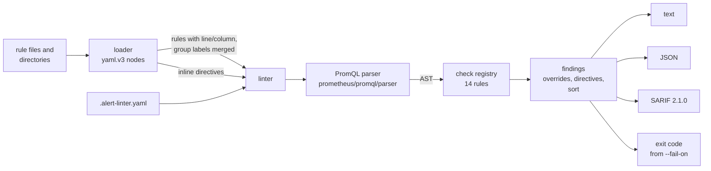

# alert-linter

A single-binary linter for Prometheus alerting rules. It catches the authoring mistakes behind noisy, unactionable pages: no `for:`, no runbook, no owner, paging on CPU instead of user impact, one page per pod.

[](https://github.com/mohammed-saaduddin-ansari/alert-linter/actions/workflows/ci.yml)

## Why I built this

`promtool check rules` tells you whether Prometheus can load a rule. It does not tell you that the rule will wake someone at 03:00 for a CPU spike nobody can act on, page forty times for one bad rollout, or arrive with no runbook. Those mistakes are cheap to catch in review and expensive to find on call, and reviewers tend to read the PromQL rather than its on-call consequence. This is a clean-room reference implementation of a pattern I have worked with: make the paging standard explicit and check it in CI. No employer or client code.

## Quickstart

Needs Go 1.26.7 or newer.

```sh
git clone https://github.com/mohammed-saaduddin-ansari/alert-linter
cd alert-linter
make build                                # -> bin/alert-linter

bin/alert-linter examples/bad-rules.yaml  # 18 findings, exit code 1
bin/alert-linter examples/good-rules.yaml # 0 findings, exit code 0
bin/alert-linter --list-rules
```

Or install it onto your `PATH`:

```sh
go install github.com/mohammed-saaduddin-ansari/alert-linter/cmd/alert-linter@main
alert-linter path/to/rules/
```

```text
alert-linter [flags] <file-or-directory>...

  --config FILE     config file (default: .alert-linter.yaml in the working directory, if present)
  --format FORMAT   text (default), json or sarif
  --output FILE     write the report to a file instead of stdout
  --fail-on LEVEL   lowest severity that fails the run: error (default), warning, info or never
  --list-rules      list all rules and exit
  --version         print the version and exit
```

Exit codes: `0` nothing at or above `--fail-on`, `1` findings at or above `--fail-on`, `2` usage error, unreadable file or invalid config. Keeping 1 and 2 apart means a broken config never looks like "your rules have problems".

Inputs can be plain Prometheus rule files or Kubernetes `PrometheusRule` manifests, including multi-document YAML. Directories are walked recursively for `*.yml`/`*.yaml` files that contain rule groups.

## Example output

Selected findings from `bin/alert-linter examples/bad-rules.yaml` (full output in [`testdata/golden/bad.txt.golden`](testdata/golden/bad.txt.golden)):

```text
examples/bad-rules.yaml:8:16: error: paging alert "HostHighCPU" (severity=critical) has no `for:`, so one bad evaluation pages someone [paging-missing-for]
    hint: add `for: 5m` (or whatever the condition needs to be meaningful) so it must persist before anyone is woken
examples/bad-rules.yaml:9:15: warning: paging alert "HostHighCPU" (severity=critical) fires on a resource cause (node_cpu_seconds_total) rather than a symptom users feel [cause-based-paging]
    hint: page on error rate, latency or SLO burn rate and send this one to a ticket (e.g. severity: warning); for disks, a predict_linear() time-to-full alert is a reasonable page
examples/bad-rules.yaml:9:15: warning: paging alert "HostHighCPU" aggregates by (instance), so one incident fans out into one page per instance [high-cardinality-grouping]
    hint: page at the service level (e.g. `sum by (namespace, job)`) and list affected instances in the description or dashboard
examples/bad-rules.yaml:10:9: warning: alert "HostHighCPU" has no owner label (team or owner) [missing-owner-label]
    hint: add a team label on the rule or once on the rule group's `labels:` so routing reaches the people who can fix it
examples/bad-rules.yaml:12:9: error: paging alert "HostHighCPU" has no runbook_url annotation [missing-runbook-url]
    hint: link a runbook that says what to check first and how to mitigate
examples/bad-rules.yaml:33:15: error: "APIHighErrorRate": rate(http_requests_total{code=~"5..",job="api"}[30s]), rate(http_requests_total{job="api"}[30s]) use windows shorter than 4 x the 1m scrape interval (4m); one missed scrape leaves too few samples and the expression returns nothing [rate-window-too-short]
    hint: use a window of at least 4m, or set scrape_interval in the config if your targets are scraped faster
examples/bad-rules.yaml:70:16: error: alert "PodCrashLooping" is defined again with identical labels (first at examples/bad-rules.yaml:47) [duplicate-alert]
    hint: Alertmanager cannot tell the two apart, so silences, inhibitions and grouping act on both; delete one or give them distinct labels such as different severity tiers
examples/bad-rules.yaml:83:15: error: "OrderQueueBacklog" has an expression that does not parse: 1:39: parse error: unclosed left parenthesis [invalid-rule]
...

18 findings (8 errors, 10 warnings) in 1 file; checked 8 alerts and 1 recording rule
```

Positions are `file:line:column`, so they are clickable in most editors. The same findings as [JSON](testdata/golden/bad.json.golden) and [SARIF](testdata/golden/bad.sarif.golden) are checked in as golden files. The good sample gives `0 findings (0 errors, 0 warnings) in 1 file; checked 7 alerts and 4 recording rules`.

## Rules

An alert is **paging** when its `severity` label is in `paging_severities` (default `critical`, `page`). Several rules only apply to paging alerts, or are stricter for them, because a bad page costs far more than a bad ticket. `bin/alert-linter --list-rules` prints the same list with default severities. The SARIF output links each rule to its section here.

### invalid-rule

Error. Broken YAML, PromQL that does not parse, invalid durations, a rule with no `expr`, with both or neither of `alert` and `record`, or with unknown fields such as `anotations:`.

Prometheus rejects the whole file when one rule is invalid. On reload it keeps running the old rules, so the new or fixed alerts in that file never go live, and nobody notices until the incident one of them should have caught.

### paging-missing-for

Error. A paging alert with no `for:`, or `for: 0s`.

Without `for:` the alert fires on the first evaluation where the expression is true. One slow scrape, pod restart or deploy blip wakes someone, and the alert has often resolved before they open a laptop.

### short-for

Warning. `for:` is set but shorter than `min_for` (default `1m`).

A `for:` under one or two evaluation intervals barely debounces anything. The alert flaps, each flap can notify, and responders learn it is noise. That learned distrust is how a real page gets ignored.

### missing-runbook-url

Error on paging alerts, warning otherwise. No `runbook_url` annotation, or one that is not an absolute `http(s)` URL. Templated values such as `{{ $externalURL }}/...` are accepted.

At 03:00 the responder needs to know what to check first and how to mitigate. A runbook makes the alert usable by someone who did not write it. A relative path like `wiki/HostOutOfMemory` is not clickable from a phone.

### missing-summary

Error on paging alerts, warning otherwise. No `summary` annotation.

The summary is the notification title in most pagers and chat integrations. Without it the responder sees an alert name and has to open a dashboard to learn what is wrong and where.

### missing-description

Warning. No `description` annotation.

The description carries what a one-line summary cannot: user impact, what the threshold means, likely blast radius. It lets the responder decide quickly whether to escalate.

### missing-severity

Error. No `severity` label (the label name is configurable).

Alertmanager routing decides from severity whether someone is woken. Without one the alert falls through to a default receiver nobody watches, or pages when it should have been a ticket.

### unknown-severity

Error. The severity is not in `allowed_severities` (default `critical`, `page`, `warning`, `info`, `none`).

Values such as `crit`, `P1` or `High` slip past routes that match exact values, so the alert goes to the wrong receiver or nowhere. This is one of the commonest ways a "critical" alert never pages.

### missing-owner-label

Warning. None of the `owner_labels` (default `team`, `owner`) is set on the rule or its group's `labels:`.

An unowned alert pages whoever holds the default route, who then has to find the right team mid-incident. Owner labels let routing reach the people who can fix it and make per-team alert-quality reviews possible.

### cause-based-paging

Warning, paging alerts only. The expression selects resource metrics: CPU, memory, load, filesystem, disk I/O, container resources, runtime memory (see `cause_metrics`). Expressions using `predict_linear()` are exempt.

High CPU or memory is a cause, not a symptom. Plenty of healthy systems run hot and plenty of outages happen at 20% CPU, so these pages fire without user impact and still miss real outages. Page on what users feel (error rate, latency, SLO burn rate) and send causes to a ticket or dashboard. A disk that will be full in four hours is the classic exception, hence the `predict_linear()` exemption.

### rate-window-too-short

Error, alerts and recording rules. `rate()`, `irate()`, `increase()`, `delta()`, `idelta()` or `deriv()` over a range shorter than `rate_window_factor` (default 4) times `scrape_interval` (default `1m`, the Prometheus default). Subqueries with an explicit step are checked against the step.

These functions need at least two samples in the window. Below about four scrapes, one missed or late scrape leaves too few samples and the expression returns nothing, which tends to happen exactly when the target is struggling. Recording rules are checked because alerts are built on them. Set `scrape_interval` to your real interval: with 15s scrapes, `[1m]` is fine.

### high-cardinality-grouping

Warning, paging alerts only. The alert aggregates `by (...)` a label in `high_cardinality_labels` (defaults include `pod`, `container`, `instance`, `path`, `user_id`).

`sum by (pod)` turns one incident into one page per pod: a bad rollout across 40 pods should be one page with the pods listed, not 40 acknowledgements. Some per-instance pages are deliberate (an etcd member, a database primary), so silence those with an [inline directive](#inline-directives) that says why.

### duplicate-alert

Error, across all files in the run. The same alert name with identical static labels is defined twice.

Alertmanager identifies alerts by labels, so the two look like one alert: silences, inhibitions and grouping act on both. The same name with different labels, typically a `warning` and a `critical` tier, is a normal pattern and is not reported.

### unknown-directive

Warning. An inline `alert-linter: disable=...` comment names a rule that does not exist.

A misspelt directive suppresses nothing, the finding keeps failing CI, and people learn to ignore the linter.

## Configuration

All keys are optional. The linter reads `.alert-linter.yaml` from the working directory, or the file given with `--config`. Unknown keys and unknown rule IDs are errors, so a typo cannot quietly turn a check off. A commented example is in [`examples/alert-linter.yaml`](examples/alert-linter.yaml).

```yaml
scrape_interval: 1m           # your global scrape interval
rate_window_factor: 4         # windows must cover this many scrapes
min_for: 1m                   # short-for threshold
paging_severities: [critical, page]
allowed_severities: [critical, page, warning, info, none]   # paging severities are always allowed
severity_label: severity
owner_labels: [team, owner]
high_cardinality_labels: [pod, pod_name, container, container_id, instance, id, uid,
                          path, url, user, user_id, request_id, trace_id, ip, client_ip]
cause_metrics: ['^node_cpu_', '^node_memory_', '^container_memory_']   # regexes; replaces the built-in list
rules:                        # per rule: off, error, warning or info
  cause-based-paging: error
  missing-description: off
fail_on: error                # error, warning, info or never; --fail-on overrides
```

The built-in `cause_metrics` list covers node exporter CPU, load, memory, filesystem and disk metrics; cAdvisor container CPU, memory and filesystem metrics; `process_cpu_seconds_total`, `process_resident_memory_bytes`, `kube_pod_container_resource_*`, `jvm_memory_*`, `go_memstats_*`; and node-mixin recording rules containing `node_cpu_utilisation` or `node_memory_utilisation`.

## Inline directives

Suppress a finding next to the rule, with the reason written down for the next reviewer:

```yaml
rules:
  # Every etcd member matters for quorum, so one page per member is intended.
  # alert-linter: disable=high-cardinality-grouping -- per-member paging is deliberate
  - alert: EtcdMemberDown
    expr: max by (instance) (up{job="etcd"}) == 0
    for: 30s # alert-linter: disable=short-for
```

`# alert-linter: disable=<id>[,<id>...]` applies to the rule whose lines contain it (a trailing comment on `for:`, say) or, between rules, to the next rule below. `# alert-linter: disable-file=<id>[,<id>...]` covers the whole file, and `all` disables every rule. Anything after the ID list, such as `-- reason`, is ignored, so use it.

## GitHub Actions and code scanning

The repository is also a composite GitHub Action ([`action.yml`](action.yml)) that builds the linter from source and runs it. With SARIF output, findings show up as code scanning alerts and as annotations on the pull request diff. SARIF lists every rule, not only those that fired, because code scanning uses the list for help text and to close fixed alerts. Full workflow: [`examples/github-workflow.yml`](examples/github-workflow.yml).

```yaml
permissions:
  contents: read
  security-events: write   # needed to upload SARIF

jobs:
  alert-linter:
    runs-on: ubuntu-latest
    steps:
      - uses: actions/checkout@v7
      # There are no release tags yet; pin to a commit SHA in real use.
      - uses: mohammed-saaduddin-ansari/alert-linter@main
        with:
          paths: monitoring/rules
          format: sarif
          output: alert-linter.sarif
      - uses: github/codeql-action/upload-sarif@v4
        if: always()            # upload even when the lint step fails
        with:
          sarif_file: alert-linter.sarif
          category: alert-linter
```

Inputs: `paths` (required, space-separated), `config`, `format`, `output`, `fail-on`. For a plain pass/fail check, drop the SARIF inputs and the upload step; the text output lands in the job log.

## How it works



The [loader](internal/loader/loader.go) decodes each file into `yaml.v3` nodes, merges group `labels:` under rule labels as Prometheus does, and records structural problems instead of aborting, so one bad rule does not hide findings in the rest of the file. Directives are attached to rules by line span. The [linter](internal/lint/lint.go) parses each `expr` once and runs the [check registry](internal/lint/checks.go): each check is a small function with an ID, a summary and a "why" that feeds `--list-rules` and the SARIF help text. `duplicate-alert` runs as a separate pass across all files. Config overrides and directives are applied last, then findings are sorted and [rendered](internal/report/report.go).

## Design decisions

**The real PromQL parser, not regexes.** Regexes cannot reliably tell `by (pod)` in an aggregation from a label matcher, or find the range of a `rate()` nested three calls deep, and false positives are what kill a linter's credibility. Using `prometheus/promql/parser` means the linter sees the AST Prometheus sees. The cost is a heavy dependency tree and a 7.6 MB stripped binary, which is fine for CI. Parsing is lenient about experimental functions; `promtool check rules` against your real Prometheus version stays the authority on what loads.

**yaml.v3 nodes for positions.** Unmarshalling into structs loses line numbers. Working with nodes is more code, but every finding points at the exact field, which is what makes the text output clickable and puts SARIF annotations on the right line of a pull request.

**Finding severity depends on whether the alert pages.** A missing runbook on a ticket is an annoyance; on a page it is a slower incident. Heuristics with legitimate exceptions (`cause-based-paging`, `high-cardinality-grouping`) only warn, while mechanical defects fail the build. That keeps CI strict where it counts without making teams fight the tool on day one. Teams that agree with the heuristics can promote them to `error` in config, as the example config does.

**Suppressions live next to the rule.** A central exemption list drifts away from the code it excuses. Inline comments travel with the rule through review, and the `-- reason` convention keeps the justification visible. With thousands of rules I would add a baseline mode, so existing findings do not block and only new ones do, and report directives that no longer suppress anything.

**Narrow and offline.** One binary, no network, no Prometheus server in CI. For checks against a live Prometheus (does this metric exist, would this query return data), Cloudflare's [pint](https://github.com/cloudflare/pint) is the more complete tool, and the two can run side by side.

## Testing

```sh
make test     # go test -race ./...
make lint     # gofmt check, go vet, golangci-lint
make golden   # regenerate golden files after an intended output change
make demo     # lint both sample files
```

Tests run offline with no credentials: 26 test functions, 64 including table-driven subtests. Statement coverage is 95.5% for `internal/lint`, 96.5% for `internal/report`, 85.1% for `internal/cli`, 82.8% for `internal/loader` and 81.9% for `internal/config`. Golden tests run the real CLI from the repository root against [`examples/`](examples) in text, JSON and SARIF, with the example config, a `PrometheusRule` manifest, `--fail-on warning` and `--list-rules`. I checked the golden SARIF against the SARIF 2.1.0 JSON schema locally with Python `jsonschema`; that check is not in CI.

[CI](.github/workflows/ci.yml) runs gofmt, `go vet`, golangci-lint and the race-enabled tests, checks that the good sample exits 0 and the bad sample exits 1, and runs the action itself with `uses: ./`.

## Limitations

- Static only. It cannot tell whether a metric exists, whether `scrape_interval` matches reality, or whether an alert would ever fire.
- `cause-based-paging` matches metric names, so causes hidden behind custom recording-rule names are missed unless you add them to `cause_metrics`.
- `high-cardinality-grouping` only looks at `by (...)`. An unaggregated paging alert such as `up == 0` also fans out per series and is not reported; flagging all of those would be too noisy.
- Multi-window burn-rate alerts are sometimes written without `for:` on purpose. The linter cannot detect that, so add a short `for:` or a directive.
- Labels added by `external_labels`, relabelling or Alertmanager are invisible, so `missing-owner-label` can be a false positive where ownership is injected elsewhere. Turn it off in that case.
- Directive line spans are exact for literal (`|`) multi-line expressions; for folded (`>`) ones the end of the rule is estimated.
- A finding about part of a multi-line `expr` points at the start of the expression, not the sub-expression.

## Roadmap

- `--fix` for mechanical issues (placeholder `for:`, normalising severity aliases).
- Report directives that no longer suppress anything.
- Check that `summary`/`description` templates reference labels the expression keeps.
- Tagged releases with prebuilt binaries, so the Action does not build from source on every run.

## Licence

[MIT](LICENSE)
